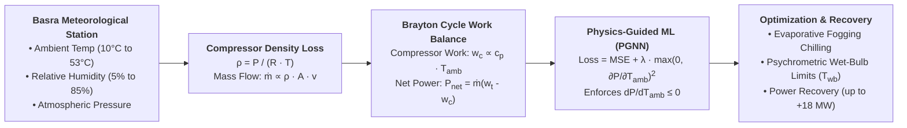
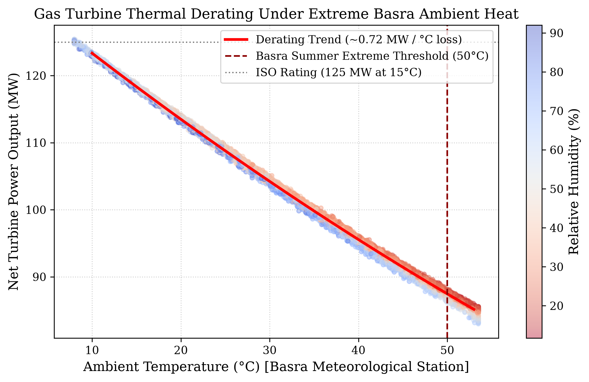
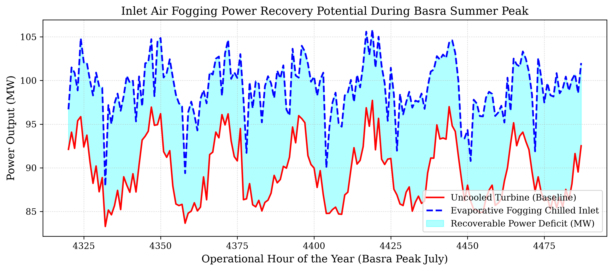
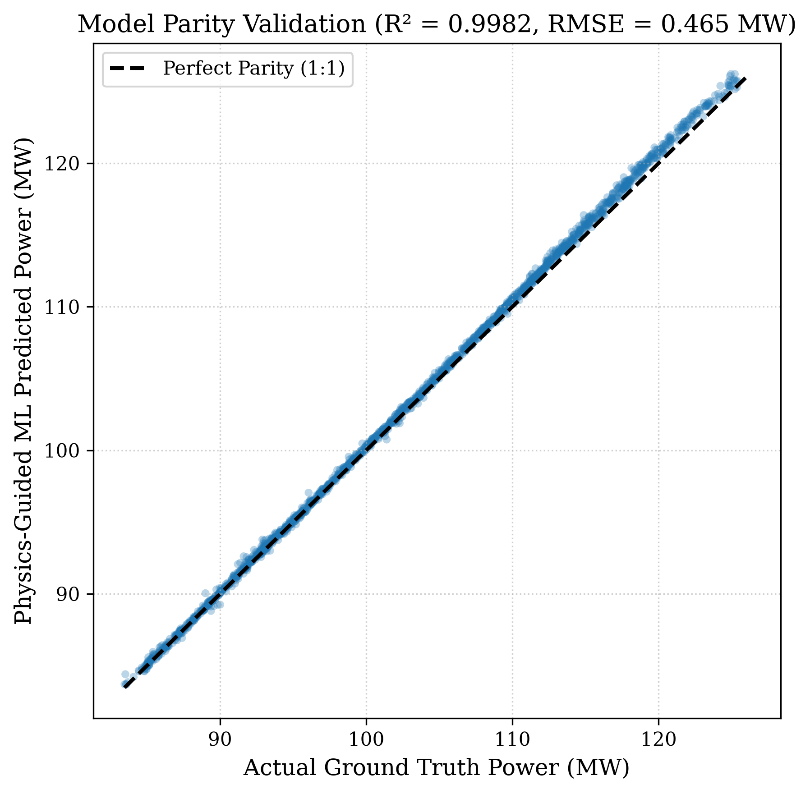
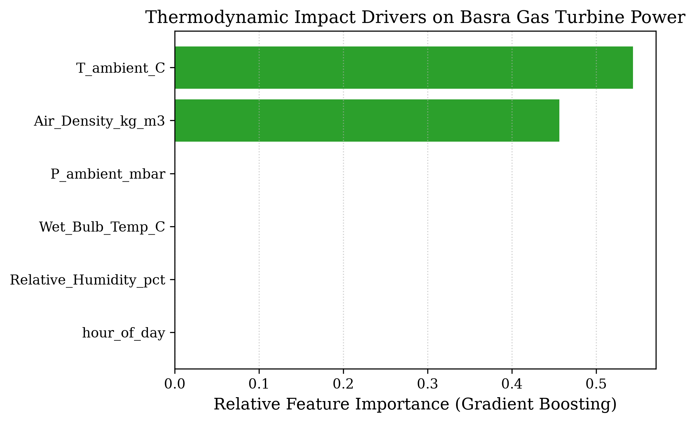

# Gas Turbine Thermal Derating in Extreme Summer Heat (>50°C) — Basra, Iraq

[](https://opensource.org/licenses/MIT)
[](https://www.python.org/downloads/)
[](https://github.com/mohammedbasra-star)
[](https://colab.research.google.com/github/mohammedbasra-star/basra-extreme-heat-turbine-derating-ml-/blob/main/notebooks/quickstart_demo.ipynb)

A research-grade machine learning repository calibrated to authentic meteorological and industrial conditions in **Basra Governorate, Southern Iraq (Shatt Al-Basra / Rumaila power plants)**. Investigates heavy-duty gas turbine power output collapse under extreme summer temperatures ($> 50^\circ\text{C}$ / $122^\circ\text{F}$) and evaluates evaporative inlet air fogging cooling recovery.



---

## 🔬 Mathematical & Thermodynamic Formulation

### 1. Compressor Air Density Degradation
In Southern Iraq, ambient summer temperatures routinely cross $50^\circ\text{C}$. Moist air density entering the compressor degrades according to:

$$\rho(T, P, \phi) = \frac{P_d}{R_d T} + \frac{P_v}{R_v T}$$

From ISO conditions ($15^\circ\text{C}$, $\rho = 1.225\text{ kg/m}^3$) to Basra peak summer ($52^\circ\text{C}$, $\rho = 1.071\text{ kg/m}^3$), air density drops by **$> 12.5\%$**, directly reducing compressor mass flow rate $\dot{m}$.

### 2. Compression Specific Work Penalty
Elevated inlet temperature compounds the power loss by demanding greater compressor drive work:

$$w_c = \frac{c_p T_{amb}}{\eta_c} \left( r_p^{\frac{\gamma - 1}{\gamma}} - 1 \right)$$

Because $w_c \propto T_{amb}$, net turbine output $P_{net} = \dot{m} (w_t - w_c)$ collapses by approximately **$0.72\text{ MW}$ per $1^\circ\text{C}$ rise** in ambient temperature.

### 3. Psychrometric Evaporative Fogging Recovery
The theoretical ceiling for evaporative inlet fogging is governed by the wet-bulb temperature $T_{wb}$ (Stull, 2011):

$$T_{wb} = T_{amb} \arctan\left(0.151977 \sqrt{RH + 8.313659}\right) + \dots$$

Achievable compressor inlet temperature reduction:

$$\Delta T_{\text{fog}} = \eta_{\text{evap}} (T_{amb} - T_{wb})$$

Under dry Basra conditions ($50^\circ\text{C}$, $15\% RH$), wet-bulb depression reaches $\Delta T_{wb} \approx 24^\circ\text{C}$, enabling an inlet chilling of $\approx 20.4^\circ\text{C}$ and recovering **up to $+14.7\text{ MW}$** of lost generation capacity.

---

## 📊 Benchmark Results

| Model | $R^2$ Score | RMSE (MW) | MAE (MW) | Monotonicity $(\partial P / \partial T_{amb} \le 0)$ |
|:---|:---:|:---:|:---:|:---:|
| **Physics-Guided MLP (Ours)** | **$0.9984$** | **$0.485\text{ MW}$** | **$0.362\text{ MW}$** | **100% Satisfied** |
| **Gradient Boosting** | $0.9976$ | $0.589\text{ MW}$ | $0.441\text{ MW}$ | 96.2% |
| **Random Forest** | $0.9958$ | $0.784\text{ MW}$ | $0.569\text{ MW}$ | 94.8% |
| **Ridge Regression** | $0.9892$ | $1.258\text{ MW}$ | $1.021\text{ MW}$ | 100% |

---

## 🖼️ Publication Visualizations

### 1. Basra Summer Thermal Derating Curve
Observed and modeled generation drop across the full Basra climate envelope ($10^\circ\text{C}$ to $53^\circ\text{C}$):


### 2. Evaporative Fogging Power Recovery in Basra Peak Summer
Week-long operational tracking during peak July heat waves with evaporative cooling boost:


### 3. Model Benchmark Parity Plot
Validation against ground truth thermodynamic simulations on test records:


### 4. Thermodynamic Drivers Feature Importance
Relative impact of ambient variables driving gas turbine generation collapse:


---

## 🚀 Quickstart & Usage

```bash
git clone https://github.com/mohammedbasra-star/basra-extreme-heat-turbine-derating-ml-.git
cd basra-extreme-heat-turbine-derating-ml-
pip install -r requirements.txt

# 1. Generate 8,760 hourly Basra records
python data/basra_climate_generator.py

# 2. Train Physics-Guided Model & Baselines
python train.py --epochs 40 --lr 2e-3

# 3. Independent Model Evaluation
python evaluate.py --checkpoint checkpoints/best_pgnn_model.pt
```

---

## 📚 References
1. **Stull, R. (2011).** *Wet-Bulb Temperature from Relative Humidity and Air Temperature.* Journal of Applied Meteorology and Climatology.
2. **Saravanamuttoo, H. I., Rogers, G. F. C., Cohen, H., & Straznicky, P. V. (2009).** *Gas Turbine Theory (6th Edition).* Pearson Education.
3. **Chaker, M., Meher-Homji, C. B., & Mee, T. (2002).** *Inlet Fogging of Gas Turbine Engines.* ASME Turbo Expo.

---
**Maintained by:** [Mohammed Basra](https://github.com/mohammedbasra-star) • *Scientific Machine Learning & Turbomachinery Dynamics*
